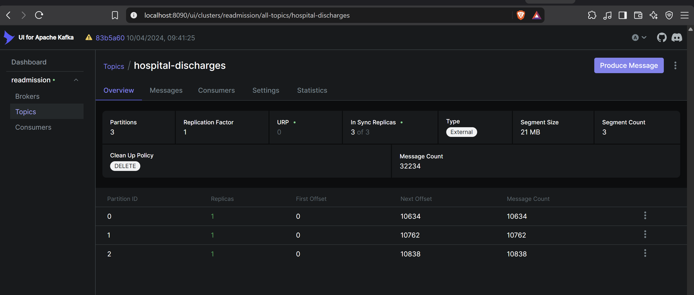
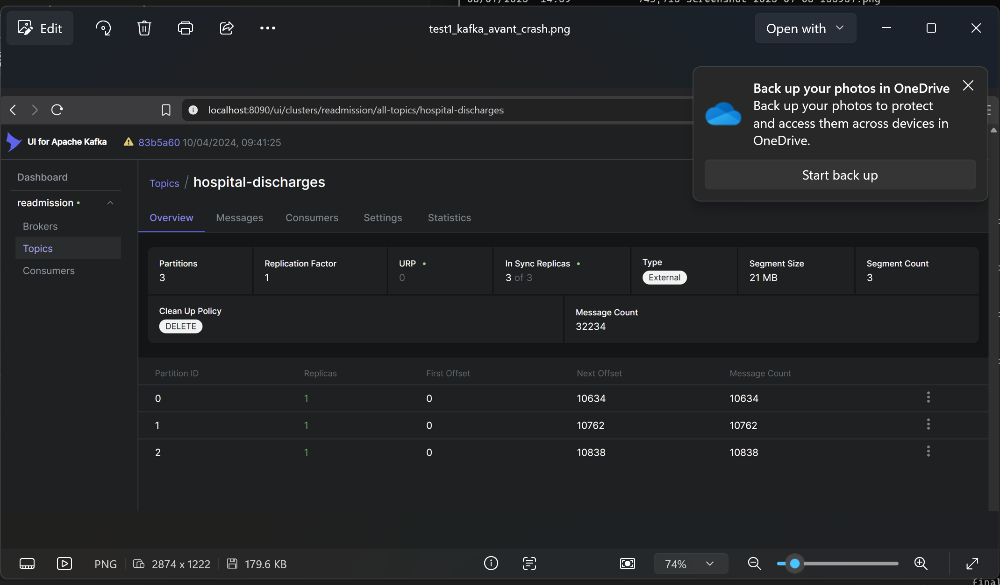
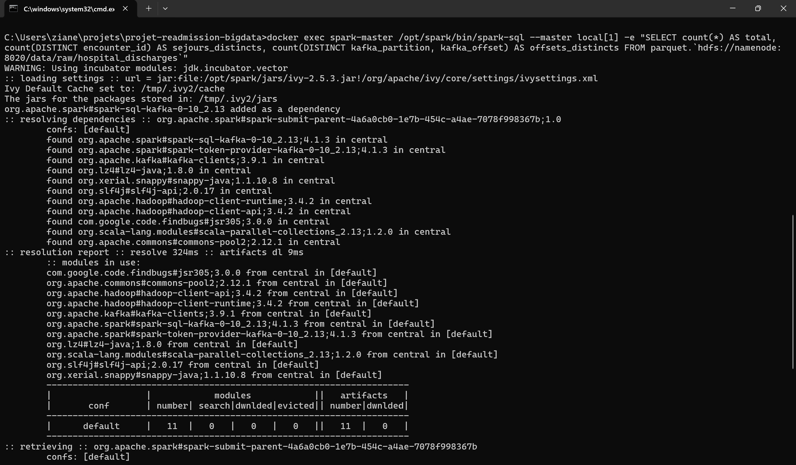
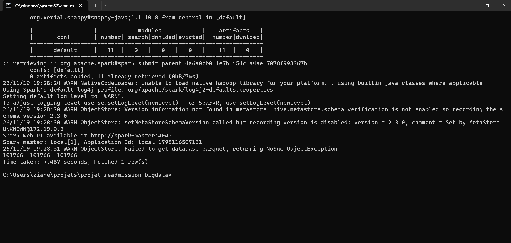
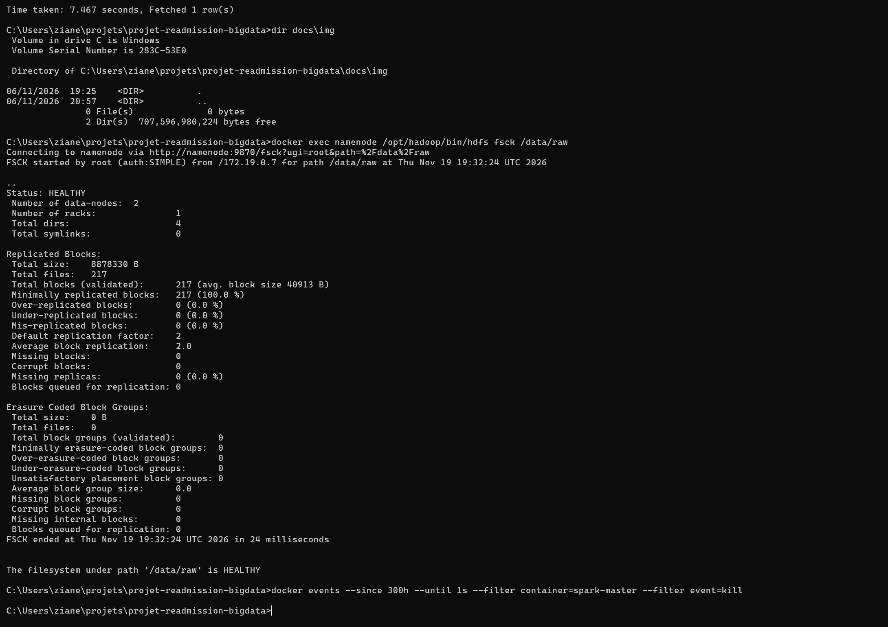

# Tests de résilience du pipeline

> **Statut : test 1 validé (PASS), test 2 à faire.**

**Objectif** : prouver que le pipeline Kafka → Spark Structured Streaming → HDFS ne perd pas et ne duplique pas de données quand un composant tombe.

**Environnement** : Docker Desktop (Windows), 12 Go de RAM alloués à WSL 2, 2 DataNodes HDFS (`dfs.replication` = 2), 2 workers Spark, 1 broker Kafka (3 partitions).
**Jeu de données** : `diabetic_data.csv`, 101 766 séjours attendus.
**Débit du producer** : environ 94 événements/s mesurés (accéléré par rapport aux 20/s par défaut pour raccourcir le test). L'envoi complet dure donc environ 18 minutes.

## État de référence (avant les tests)

- `hdfs dfsadmin -report` : **Live datanodes (2)**, 0 bloc sous-répliqué, 0 bloc manquant.
- `hdfs getconf -confKey dfs.replication` : **2**.
- Topic Kafka `hospital-discharges` : 3 partitions, vide au départ.

## Test 1 : arrêt brutal de Spark en plein run (checkpoint)

### Commandes exécutées

```powershell
docker compose up -d --build
powershell -ExecutionPolicy Bypass -File scripts\start_archive.ps1
docker compose --profile ingestion up -d producer
# surveillance du compteur dans Kafka UI (localhost:8090)
docker exec namenode /opt/hadoop/bin/hdfs dfs -ls /data/raw/hospital_discharges/_spark_metadata
docker exec namenode /opt/hadoop/bin/hdfs dfs -ls /checkpoints/archive_raw/offsets
docker kill spark-master
docker ps
docker start spark-master
powershell -ExecutionPolicy Bypass -File scripts\start_archive.ps1
docker exec namenode /opt/hadoop/bin/hdfs dfs -ls /checkpoints/archive_raw/offsets
docker exec spark-master /opt/spark/bin/spark-sql --master local[1] -e "SELECT count(*) AS total, count(DISTINCT encounter_id) AS sejours_distincts, count(DISTINCT kafka_partition, kafka_offset) AS offsets_distincts FROM parquet.`hdfs://namenode:8020/data/raw/hospital_discharges`"
docker exec namenode /opt/hadoop/bin/hdfs fsck /data/raw
```

### Observations

- Le job d'archivage tournait depuis 20:30 (UTC) et le producer a démarré à 20:36:20.
- **Avant le crash** (relevé à 20:42) : le dernier lot validé dans `_spark_metadata` est le **18**, et le dossier `offsets/` du checkpoint va jusqu'au **19** (lot planifié, pas encore validé). Kafka contenait alors **32 234 messages** (capture à 20:42:07).
- **Crash** : `docker kill spark-master` vers 20:44 (UTC), soit environ 40 000 à 45 000 messages dans Kafka (estimation à partir de 32 234 messages à 20:42:07 et d'un débit de 94 messages/s). `docker ps` ne montre plus `spark-master`, alors que les deux workers, les DataNodes, Kafka et le producer continuent de tourner. Le producer continue d'envoyer pendant la panne. Spark avait déjà traité les lots 20 à 23 entre le relevé et le kill.
- **Reprise** : `docker start spark-master`, puis `start_archive.ps1`. Le journal affiche `Archivage démarré` vers 20:44:07 (UTC), suivi de `[batch 24] 1055 événements archivés`. La numérotation des lots **continue** (24, 25, 26...) au lieu de repartir de 0 : Spark a relu son checkpoint dans HDFS. Le dossier `offsets/` s'allonge sans retour à zéro.
- Ensuite, Spark traite environ 1 890 événements par lot toutes les 20 secondes, soit le rythme du producer : il a rattrapé les messages arrivés pendant la panne sans accumuler de retard.
- Après la fin du producer, Docker Desktop a été redémarré : les données sont restées dans HDFS (volumes persistants). Le comptage final a été fait le 19/11/2026 à 19:28 (UTC).




### Résultats chiffrés

| Mesure | Valeur |
|---|---|
| Dernier lot validé relevé avant le kill (20:42) | 18 |
| Dernier fichier d'offsets relevé avant le kill (20:42) | 19 |
| Premier lot après la reprise | 24 (la numérotation continue) |
| Temps de reprise | moins d'une minute entre le kill et le redémarrage ; job actif environ 5 s après `start_archive.ps1` (20:44:04 → premier lot vers 20:44:09). Estimation : Docker n'a pas conservé l'heure exacte du kill. |
| Lignes dans HDFS (`count(*)`) | **101 766** (attendu 101 766) |
| Séjours distincts (`encounter_id`) | **101 766** |
| Positions Kafka distinctes (partition + offset) | **101 766** |
| `fsck /data/raw` | HEALTHY, 217 blocs, réplication moyenne 2.0, 0 sous-répliqué |





### Verdict : PASS

Les trois comptages sont identiques et égaux au nombre de séjours du fichier source : **aucune perte et aucun doublon** après l'arrêt brutal de Spark. Le checkpoint (offsets dans HDFS) et le journal de métadonnées du sink Parquet (`_spark_metadata`) permettent une reprise exactement-une-fois : un lot incomplet au moment du crash n'est jamais compté deux fois.

## Test 2 : arrêt d'un DataNode

À FAIRE. Plan :

1. Pendant que l'archivage tourne : `docker stop datanode1`.
2. `hdfs dfsadmin -report` : 1 DataNode vivant attendu (le NameNode peut mettre plusieurs minutes à constater la panne).
3. Vérifier que Spark continue d'écrire.
4. `hdfs fsck /data/raw` : blocs sous-répliqués attendus (une seule copie).
5. `docker start datanode1`, puis `fsck` régulièrement jusqu'à `HEALTHY`. Noter le temps de récupération.

## Conclusion

À COMPLÉTER après le test 2.